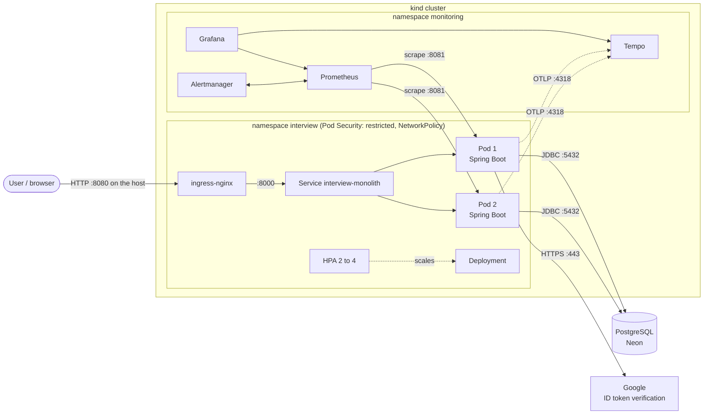
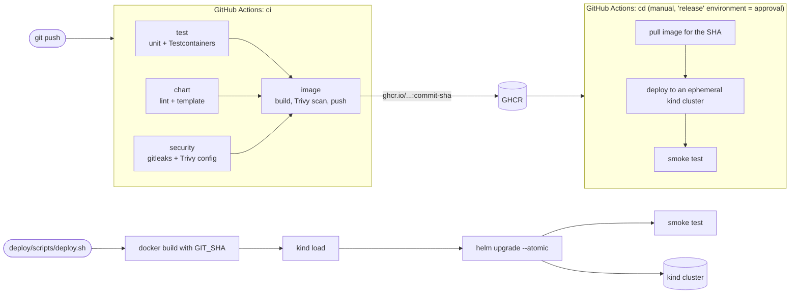

# Architecture

The application is one Spring Boot service (a deliberate monolith) backed by one PostgreSQL database. This page shows
how a request is served, how a commit reaches the cluster, and how the system is observed.

## 1. Request path (runtime)

Inside a pod a request goes: `JwtAuthenticationFilter` (verifies the token, rebuilds `X-User-Id` / `X-User-Role`) ->
controller -> service -> Spring Data repository -> PostgreSQL. Notifications are in-process calls and are
best-effort: a failure is logged and never fails the user's request.

Ports: `8000` is the API and the only port the Ingress routes to; `8081` is the actuator (health, info, Prometheus)
and is reachable only from the `monitoring` namespace.

## 2. Delivery path (commit to running pod)

- The image tag is the full commit SHA, and the same SHA is stored in the image label, in the pod's
  `app.kubernetes.io/version` label and in `/actuator/info`. `smoke-test.sh` fails if they disagree.
- A pull request builds and scans the image but never publishes it; only pushes publish.
- A change that does not pass `test`, `chart` and `security` never produces an image.

## 3. Observability path

| Signal | Source | Stored in | Looked at in |
|---|---|---|---|
| Metrics | Micrometer: HTTP latency histograms, JVM, Hikari pool, business counters | Prometheus (scrape every 15 s) | Grafana dashboard *Interview Monolith: service health* |
| Alerts | PrometheusRule: SLO burn-rate, latency, replicas, DB pool/timeouts | Prometheus / Alertmanager | Prometheus *Alerts*, `docs/runbook.md` |
| Traces | OpenTelemetry (Micrometer bridge) over OTLP/HTTP | Tempo | Grafana > Explore > Tempo |
| Logs | JSON on stdout (ECS format) with `traceId` / `spanId` | the container runtime | `kubectl logs` (no log aggregation, see decisions) |

## 4. Failure boundaries

| If this fails | What users see | What keeps working | How it is detected |
|---|---|---|---|
| One app pod | Nothing (the Service drops it when it is unready) | The other replica | `InterviewReplicasUnavailable` |
| A bad release | Nothing: new pods never become Ready, old ones keep serving; `--atomic` rolls back | The old version | Failed `helm upgrade`, `InterviewReplicasUnavailable` |
| PostgreSQL / Neon | 5xx on every data request after the 10 s pool timeout | Pods stay up and Ready; `/auth/google` fails too | `InterviewDbConnectionTimeouts`, then the error-budget burn alerts |
| Google (token verification) | Sign-in returns 503; users who already have a token are unaffected | All other endpoints | Elevated 503 on `POST /auth/google` |
| Tempo / Prometheus | Nothing (the app only pushes spans best-effort) | The app | Missing data on the dashboard |
| The Ingress controller | The site is unreachable | The pods | Synthetic request fails |

The rehearsed failure (database down, then restored) is written up in `docs/fault-demo-db-outage.md`.
